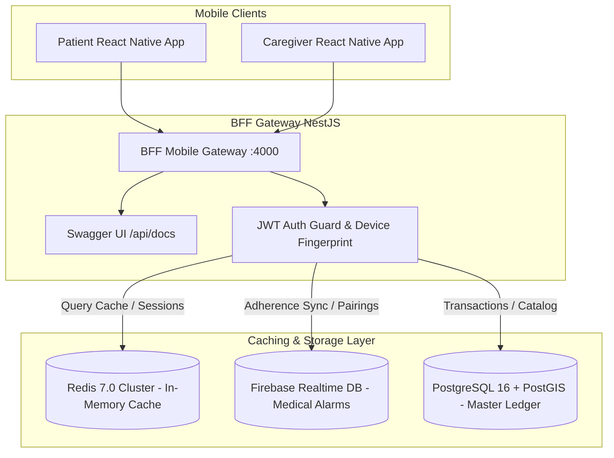

# Architecture, Environment Configuration & API Testing Guide

> **Target Workspace:** `/Users/pratikshadoshi/RN-Stuff`  
> **Interactive Swagger UI:** `http://localhost:4000/api/docs`  
> **OpenAPI 3.0 Spec:** [swagger-spec.json](file:///Users/pratikshadoshi/RN-Stuff/swagger-spec.json)  
> **Postman Collection v2.1:** [postman-collection.json](file:///Users/pratikshadoshi/RN-Stuff/postman-collection.json)

---

## 1. Environment Configurations (`.env.*`)

Environment configurations are separated per deployment stage and strictly typed via `@internal/config` using Zod schemas:

| Environment File | Stage | Data Source Mode | Database Pool | Target Use-Case |
|---|---|---|---|---|
| [`.env.development`](file:///Users/pratikshadoshi/RN-Stuff/.env.development) | Local Dev | `mock` (In-memory + Outbox) | 2–10 | Rapid local developer iteration without Docker |
| [`.env.qat`](file:///Users/pratikshadoshi/RN-Stuff/.env.qat) | Quality Assurance | `mock` or `postgres` | 5–20 | Automated CI/CD integration testing |
| [`.env.staging`](file:///Users/pratikshadoshi/RN-Stuff/.env.staging) | Pre-Production | `firebase` + `postgres` | 5–30 | End-to-end user acceptance testing (UAT) |
| [`.env.production`](file:///Users/pratikshadoshi/RN-Stuff/.env.production) | Production | `firebase` + `postgres` (RDS HA) | 10–50 | Multi-region, high-availability live deployment |
| [`.env.example`](file:///Users/pratikshadoshi/RN-Stuff/.env.example) | Template | N/A | N/A | Baseline schema for new developer onboarding |

### How to Switch Environments:
```bash
# To run BFF in development mode:
NODE_ENV=development pnpm --filter @resonance/bff-mobile dev

# To run in QAT mode:
NODE_ENV=qat pnpm --filter @resonance/bff-mobile start

# To run in Staging with live Firebase / Postgres:
NODE_ENV=staging pnpm --filter @resonance/bff-mobile start
```

---

## 2. Interactive Swagger / OpenAPI 3.0

The Backend-For-Frontend server hosts a real-time, interactive **Swagger UI**:

1. Start the server:
   ```bash
   pnpm --filter @resonance/bff-mobile dev
   ```
2. Open your browser:
   ```
   http://localhost:4000/api/docs
   ```
3. Explore and execute all documented routes:
   - **`Medical`**: Patient schedules, dose acknowledgments (`/taken`), caregiver prescriptions, critical alerts, and 4-digit PIN pairing (`/pairing`).
   - **`Feed`**: Anti-swipe resonance feed with cultural affinity sections.
   - **`Scenes`**: Physical venue check-ins and mutual waves.
   - **`Interactions`**: Pairwise kudos and mutual resonance matching.

---

## 3. Testing with External Tools (Postman / Insomnia / cURL)

You can test all endpoints directly using Postman or Insomnia without running the React Native frontend:

### Option A: Import Postman Collection
1. Open **Postman**.
2. Click **Import** (top left).
3. Select or drag-and-drop [`postman-collection.json`](file:///Users/pratikshadoshi/RN-Stuff/postman-collection.json).
4. All collection requests are pre-configured with:
   - `{{BASE_URL}}` = `http://localhost:4000`
   - `{{JWT_TOKEN}}` = `sample_jwt_access_token`
   - Headers: `Accept: application/json`, `x-client-platform: ios`, `x-client-version: 1.0.0`

### Option B: Quick cURL Commands

#### 1. Fetch Today's Medication Reminders (Patient pt_101)
```bash
curl -X GET "http://localhost:4000/medical/patients/pt_101/schedules" \
  -H "Accept: application/json"
```

#### 2. 1-Tap Confirmation ("I Took It")
```bash
curl -X POST "http://localhost:4000/medical/patients/pt_101/reminders/rem_001/taken" \
  -H "Content-Type: application/json"
```

#### 3. Fetch Caregiver Critical Alerts (Caregiver cg_202)
```bash
curl -X GET "http://localhost:4000/medical/caregivers/cg_202/alerts" \
  -H "Accept: application/json"
```

#### 4. Pair Patient via 4-Digit PIN
```bash
curl -X POST "http://localhost:4000/medical/pairing" \
  -H "Content-Type: application/json" \
  -d '{"patientLoginId": "AAJI101", "pin": "1234", "caregiverUid": "cg_202"}'
```

---

## 4. True BFF & Downstream Microservices Architecture



### Dynamic Adapter Injection
The BFF uses the Strategy & Factory pattern. Based on `ACTIVE_DATA_SOURCE` in `.env.*`:
- **`mock`**: In-memory state with immediate local outbox resolution (used for fast offline testing).
- **`firebase`**: Connects to Firebase Realtime Database via `firebase-admin` SDK with optimistic local outbox writes.
- **`postgres`**: Connects via TypeORM / Prisma connection pool with read-replicas for catalog and double-entry ledger operations.

---

## 5. Client-Side Caching (TanStack / React Query) & Offline Outbox

In `apps/mobile`:
- Network queries are cached using **Stale-While-Revalidate** policies.
- When an elderly patient taps **"I Took It"**:
  1. The UI transitions to the green **"Taken"** state instantly with zero network lag.
  2. The action is stored in the local SQLite/MMKV **Outbox Queue**.
  3. The outbox processor checks for network connectivity and automatically syncs with `POST /medical/patients/:id/reminders/:id/taken`.
  4. React Query invalidates the cache query key `['schedules', patientId]`.

---

## 6. Monorepo Verification Commands

Run the full automated test suite and type check:
```bash
# Run all unit and integration tests across 10 packages
pnpm test

# Run strict TypeScript compiler verification across all packages
pnpm typecheck
```
