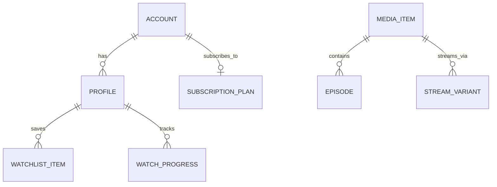

# 03 - Streaming Media Platform (Netflix / Disney+ Hotstar)

## 1. Executive Summary & Industry Benchmark
- **Benchmarked Applications:** Netflix, Disney+ Hotstar, Amazon Prime Video.
- **Core Mission:** Deliver high-throughput, low-latency adaptive video streaming, live sports event feeds, personalized recommendation carousels, multi-profile management, DRM-protected offline downloads, and multi-tier subscription paywalls.
- **Form Factors:** Mobile (iOS/Android), Tablet, Smart TV / Android TV Leanback companion.

---

## 2. Functional Domains & Key User Journeys
1. **Dynamic Content Discovery & Carousels:** Hero banners with autoplay previews (muted), curated genre trays, "Continue Watching", "Top 10 Today", and algorithmic recommendations.
2. **Video Player Experience:**
   - Adaptive Bitrate (ABR via HLS / MPEG-DASH).
   - Audio track switching (5.1 surround, multi-language dubbing).
   - Subtitle/CC track selector with styling customization.
   - Dual-tap seek (10s back/forward), scrubber timeline thumbnail preview.
   - Picture-in-Picture (PiP) and background audio playback.
3. **Live Stream & High-Concurrency Events:**
   - Low-latency HLS (LL-HLS) for live sports matches.
   - Real-time interactive overlay (live scoreboard, poll, emoji reactions via WebSockets).
4. **DRM & Offline Downloads:**
   - FairPlay (iOS) and Widevine Modular L1/L3 (Android) encrypted offline storage.
   - Smart download management: auto-delete completed episodes, auto-download next episode over Wi-Fi.
5. **Multi-Profile & Parental Controls:**
   - Up to 5 profiles per household account (Kids profile mode with age rating filters: G, PG-13, TV-MA).
   - 4-digit profile PIN lock.

---

## 3. Domain Model & Key Attributes



### Key Attributes
- **MediaItem:** `id`, `title`, `slug`, `type` (MOVIE | SERIES | LIVE), `maturityRating` (ALL, 7+, 13+, 16+, 18+), `durationSeconds`, `releaseYear`, `genres`, `cast`, `directors`, `thumbnailUrl`, `heroBannerUrl`, `trailerHlsUrl`.
- **StreamManifest:** `contentId`, `drmType` (WIDEVINE | FAIRPLAY), `licenseServerUrl`, `masterPlaylistUrl` (HLS .m3u8), `dashManifestUrl` (.mpd), `availableAudioLanguages`, `availableSubtitles`, `bitrateTiers`.
- **WatchProgress:** `profileId`, `contentId`, `lastPlaybackPositionSec`, `totalDurationSec`, `percentageCompleted`, `completedFlag`, `lastUpdatedUtc`.
- **OfflineLicense:** `licenseToken`, `expiryUtc`, `offlineKeySetId`, `contentAssetPath`, `storageSizeBytes`.

---

## 4. TypeScript DTOs & Contracts

```typescript
export type MediaType = 'MOVIE' | 'SERIES' | 'LIVE_EVENT';
export type MaturityRating = 'U' | 'UA_7' | 'UA_13' | 'UA_16' | 'A';

export interface StreamSessionResponseDto {
  sessionId: string;
  playbackUrl: string; // Master HLS / DASH manifest
  drm: {
    system: 'WIDEVINE' | 'FAIRPLAY' | 'CLEARKEY';
    licenseServerUrl: string;
    certificateUrl?: string;
    authHeader: string;
  };
  audioTracks: Array<{ id: string; language: string; label: string; isDefault: boolean }>;
  subtitleTracks: Array<{ id: string; language: string; label: string; vttUrl: string }>;
  watermark: { text: string; intervalMs: number; opacity: number };
}

export interface WatchProgressSyncDto {
  profileId: string;
  contentId: string;
  episodeId?: string;
  playbackSeconds: number;
  totalDurationSeconds: number;
  clientTimestamp: string;
}

export interface MediaFeedTrayDto {
  trayId: string;
  title: string;
  trayType: 'HERO_CAROUSEL' | 'CONTINUE_WATCHING' | 'PORTRAIT_POSTER' | 'LANDSCAPE_THUMBNAIL';
  items: Array<{
    id: string;
    title: string;
    thumbnailUrl: string;
    maturityRating: MaturityRating;
    badgeText?: string; // e.g. "TOP 10", "LIVE", "NEW EPISODE"
    progressPercentage?: number;
  }>;
}
```

---

## 5. UI Components Catalog (`@internal/ui-kit`)
1. `VideoPlayerControls`: Play/pause, dynamic scrubber with preview thumbnails, seek buttons, quality/audio/subtitle bottom sheet triggers.
2. `HeroBillboardAutoplay`: Full-width banner that seamlessly fades from poster art into a muted preview video loop with volume toggle and action buttons ("Play", "My List").
3. `ContentTrayHorizontalList`: High-performance virtualized horizontal list for media cards with skeleton shimmer loading.
4. `SubtitleAudioSelectorModal`: Tabbed modal for instant audio language switching and subtitle styling preview.
5. `DownloadProgressBar`: Animated progress indicator showing DRM license fetching, video chunks decryption, and storage utilization.

---

## 6. BFF & Microservices Architecture
- **Media Catalog Service:** Read-heavy service cached with Redis and Cloudflare CDN; provides cached feed trays and search queries with Meilisearch/Elasticsearch.
- **Playback & DRM Token Service:** Issues short-lived JWT-signed DRM playback sessions and handles heartbeat pings every 30 seconds for concurrent stream limit enforcement (e.g. 2 screens vs 4 screens).
- **Telemetry & Watch Progress Pipeline:** Kafka-backed stream ingest that buffers watch progress updates without thrashing the primary database, calculating analytics and personalized "Continue Watching" recalculations.
