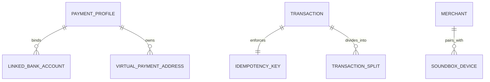

# 04 - Digital Payments & Unified Transaction Platform (UPI / PhonePe / Google Pay / Venmo)

## 1. Executive Summary & Industry Benchmark
- **Benchmarked Applications:** PhonePe, Google Pay, Paytm, Cash App, Venmo.
- **Core Mission:** High-assurance financial transaction routing, instant peer-to-peer (P2P) transfers, BharatQR / dynamic merchant QR scanning, group bill splitting, merchant audio receipt soundboxes, wallet top-ups, and biometric re-authentication for every high-value event.
- **Form Factors:** Mobile (iOS/Android), Merchant POS Terminal / Soundbox companion display.

---

## 2. Functional Domains & Key User Journeys
1. **Dynamic QR Code Scanner & Merchant Payment:**
   - Real-time camera scanner with QR parsing (UPI intent `upi://pay`, EMVCo QR standards).
   - Dynamic merchant discount application, merchant verification badge (trusted KYC seal).
2. **P2P Transfers & Split Bills:**
   - Phone contacts sync with registered payment proxy (VPA / Phone / Email).
   - Multi-party bill splitting with proportional calculation, reminders, and auto-settlement.
3. **Biometric Security & MPIN Gateway:**
   - Biometric prompt (FaceID / Fingerprint) before opening payment screen.
   - Hardware-backed keystore integration for MPIN encryption; zero-knowledge credential transport.
4. **Instant Payment Soundbox & Real-Time Audio Receipts:**
   - Real-time push / MQTT broadcast to merchant device or audio speaker in local languages ("Received 150 Rupees on PhonePe").
5. **Passbook & Transaction Ledger:**
   - Categorized ledger (Groceries, Utilities, Travel, Dining).
   - Dispute management and chargeback ticketing with automated bank reversal tracking.

---

## 3. Domain Model & Key Attributes



### Key Attributes
- **PaymentProfile:** `userId`, `vpa` (e.g. `user@okhdfcbank`), `defaultAccountId`, `kycStatus` (FULL_KYC | MINIMUM_KYC), `dailyLimitRemaining`, `fraudRiskScore`.
- **LinkedBankAccount:** `accountId`, `bankName`, `accountNumberMasked` (e.g. `XXXX-1234`), `ifscCode`, `accountType` (SAVINGS | CURRENT | WALLET), `isMpinSet`.
- **PaymentTransaction:** `txnId`, `idempotencyKey`, `senderVpa`, `receiverVpa`, `amount`, `currency` (INR, USD, EUR), `status` (INITIATED | PENDING_NPCI | SUCCESS | FAILED | REVERSED), `paymentMethod` (UPI | CARD | WALLET | NETBANKING), `rrn` (Retrieval Reference Number), `errorCode`, `createdAtUtc`.
- **SoundboxReceipt:** `deviceId`, `merchantId`, `amount`, `currencySymbol`, `ttsAudioUrl`, `broadcastTimestamp`.

---

## 4. TypeScript DTOs & Contracts

```typescript
export type TransactionStatus = 'INITIATED' | 'PROCESSING' | 'SUCCESS' | 'FAILED' | 'REVERSED';

export interface InitiatePaymentRequestDto {
  idempotencyKey: string;
  sourceAccountId: string;
  recipientVpaOrIdentifier: string;
  amount: number;
  currency: string;
  note?: string;
  deviceFingerprint: {
    deviceId: string;
    ipAddress: string;
    geoLat: number;
    geoLng: number;
    simSlotIndex: number;
  };
}

export interface PaymentExecutionResultDto {
  transactionId: string;
  bankReferenceNumber: string; // RRN
  status: TransactionStatus;
  amount: number;
  currency: string;
  timestamp: string;
  recipientName: string;
  feeAmount: number;
  cashbackEarned?: number;
  soundboxBroadcastStatus?: 'SENT' | 'QUEUED' | 'N_A';
}

export interface SplitBillGroupDto {
  billId: string;
  totalAmount: number;
  organizerVpa: string;
  splits: Array<{
    participantVpa: string;
    allocatedAmount: number;
    paidStatus: 'PAID' | 'PENDING' | 'DECLINED';
    settledTxnId?: string;
  }>;
}
```

---

## 5. UI Components Catalog (`@internal/ui-kit`)
1. `CameraQrScannerOverlay`: Smooth crosshair viewfinder with torch toggle, gallery QR photo picker, and vibration feedback upon decoding.
2. `NumericAmountKeypad`: Oversized, accessible financial keypad with currency glyph prefix, formatted thousands separators, and quick denomination chips (+₹100, +₹500, +₹1000).
3. `PaymentStateSuccessModal`: Celebratory animation with sound chime, bank verification tick, shareable receipt screenshot generator, and reward scratch card trigger.
4. `BankCardSelectorSheet`: Radio card carousel showing bank logos, masked account digits, and real-time balance inquiry button.
5. `FraudSecurityWarningBanner`: High-contrast warning alert triggered when paying unverified numbers or newly registered VPAs.

---

## 6. BFF & Microservices Architecture
- **Payment Switch Gateway:** Ultra-low latency payment orchestration layer connected via ISO 8583 / ISO 20022 message specs to NPCI / Banking API switches with strict timeout budgets (< 3000ms).
- **Idempotency & Distributed Lock Engine:** Redis Redlock cluster guaranteeing that duplicate network retries or double clicks cannot debit a bank account twice.
- **Fraud & Anomaly Scoring Engine:** Real-time ML inference scoring device integrity, SIM card IMSI changes, velocity checks, and geolocation discrepancies before approving transactions.
- **Merchant Soundbox Dispatch Service:** MQTT broker broadcasting text-to-speech audio payloads to merchant soundboxes within 400ms of payment completion.
