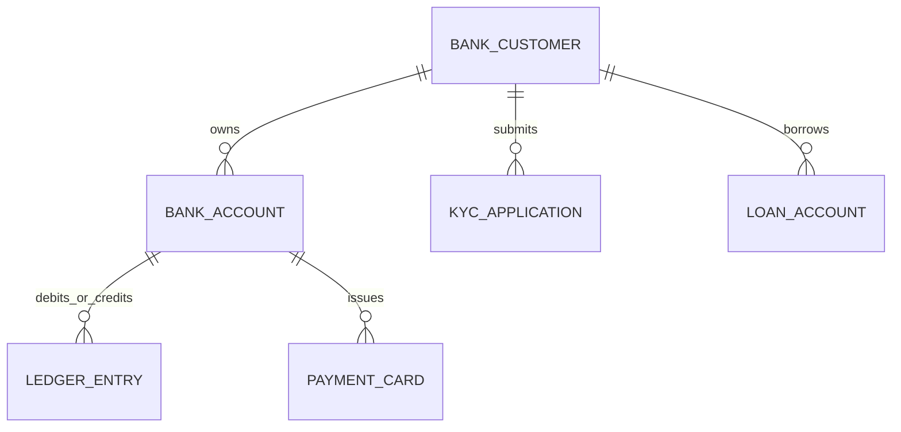

# 05 - Core Banking & Digital Financial Services (Neo-Bank / Enterprise Retail Banking)

## 1. Executive Summary & Industry Benchmark
- **Benchmarked Applications:** Revolut, Chase Mobile, HDFC MobileBanking, Monzo, N26.
- **Core Mission:** Full-lifecycle digital banking platform featuring immutable double-entry general ledger, multi-currency accounts, debit/credit card controls (freeze, limits, international toggle), fixed deposits & loans, KYC verification with biometric liveness checks, and auditable financial statements.
- **Form Factors:** Mobile (iOS/Android), Customer Web Portal, Teller/Branch Admin Console.

---

## 2. Functional Domains & Key User Journeys
1. **Digital Onboarding & e-KYC:**
   - Identity verification (National ID / Passport / Aadhaar) with OCR extraction.
   - Real-time video KYC & facial liveness match against ID photo.
2. **Account Management & Multi-Currency Wallets:**
   - Checking, Savings, and Fixed Term Deposit accounts.
   - Real-time balance inquiry, IBAN / SWIFT / routing number generation.
   - Multi-currency sub-accounts with live interbank FX exchange rates.
3. **Card Lifecycle & Controls:**
   - Virtual and physical card generation with disposable virtual numbers for e-commerce.
   - Instant freeze/unfreeze switch, contactless toggle, ATM withdrawal limit slider, and international usage lock.
4. **Domestic & International Fund Transfers:**
   - RTGS, NEFT, IMPS, ACH, Wire, and SEPA transfers with scheduled/recurring rules.
   - Beneficiary address book with cool-off period enforcement (e.g. 24h limit on new payees).
5. **Auditing, Statements & Tax Reports:**
   - Password-protected PDF/CSV statement generation with digital cryptographic stamp.
   - Spend analytics categorization with automated budget goal notifications.

---

## 3. Domain Model & Key Attributes



### Key Attributes
- **BankCustomer:** `customerId`, `cifNumber` (Customer Information File), `legalName`, `email`, `phone`, `kycLevel` (TIER_1 | TIER_2 | FULL), `riskCategory` (LOW | MEDIUM | HIGH), `fatcaDeclarationStatus`.
- **BankAccount:** `accountId`, `accountNumber`, `currency` (USD, EUR, GBP, INR), `balanceAvailable`, `balanceLockedHold`, `overdraftLimit`, `interestRateAnnual`, `status` (ACTIVE | DORMANT | FROZEN | CLOSED).
- **LedgerEntry (Immutable Double Entry):** `entryId`, `transactionRefId`, `sourceAccountId`, `destinationAccountId`, `debitAmount`, `creditAmount`, `currency`, `effectiveTimestampUtc`, `hashSignature`.
- **PaymentCard:** `cardId`, `accountId`, `cardPanMasked`, `expiryMonth`, `expiryYear`, `cardType` (PHYSICAL | VIRTUAL | DISPOSABLE), `isFrozen`, `dailyAtmLimit`, `dailyOnlineLimit`, `isContactlessEnabled`, `isInternationalEnabled`.

---

## 4. TypeScript DTOs & Contracts

```typescript
export type AccountTier = 'SAVINGS_STANDARD' | 'SAVINGS_PREMIUM' | 'CHECKING_BUSINESS';
export type CardActionType = 'FREEZE' | 'UNFREEZE' | 'SET_LIMITS' | 'REPLACE_STOLEN';

export interface BankAccountSummaryDto {
  accountId: string;
  accountNumberMasked: string;
  accountType: AccountTier;
  currency: string;
  availableBalance: number;
  unclearedBalance: number;
  interestAccrued: number;
  ibanOrRouting: string;
  swiftBic: string;
}

export interface CardControlUpdateRequestDto {
  cardId: string;
  action: CardActionType;
  newDailyOnlineLimit?: number;
  newDailyAtmLimit?: number;
  contactlessEnabled?: boolean;
  internationalUsageEnabled?: boolean;
  clientAuthToken: string; // 2FA Step-up OTP token
}

export interface StatementGenerationRequestDto {
  accountId: string;
  startDate: string; // ISO8601
  endDate: string;
  exportFormat: 'PDF' | 'CSV' | 'EXCEL';
  passwordProtect: boolean;
}
```

---

## 5. UI Components Catalog (`@internal/ui-kit`)
1. `InteractiveCreditCardView`: 3D flipping credit card component with realistic metallic shaders, tap to reveal CVV with automatic 30s concealment countdown.
2. `CardSecurityToggleList`: Clean, tactile toggle switches for "Freeze Card", "Allow ATM Withdrawals", "Allow International", and "Contactless".
3. `FinancialStatementFilterBar`: Date-range picker, transaction type tabs (Credits / Debits), and instant search filter.
4. `KycDocumentScannerGuide`: Camera frame overlay with automatic edge-detection and glare-detection feedback for ID document capture.
5. `AccountBalanceHeroCard`: Glassmorphic account balance summary with eye toggle to hide balance in public, and action pills ("Transfer", "Deposit", "Cards", "Analytics").

---

## 6. BFF & Microservices Architecture
- **Core Ledger Service:** Double-entry accounting system backed by an immutable ledger (e.g. Amazon QLDB or PostgreSQL with hash chaining and write-ahead cryptographic auditing).
- **KYC & AML Compliance Pipeline:** Integrates with third-party verification bureaus, sanctions watchlist screening (OFAC, PEP), and document OCR parsing.
- **Card Network Switch Integrator:** Interfaces with Visa / Mastercard issuing APIs (via Marqeta or Core Bank Switch) handling zero-latency auth webhooks for card swipes.
- **Reporting & Statement Engine:** Serverless queue worker that renders cryptographically signed PDF statements to S3 / Cloud Storage with signed expirable download URLs.
