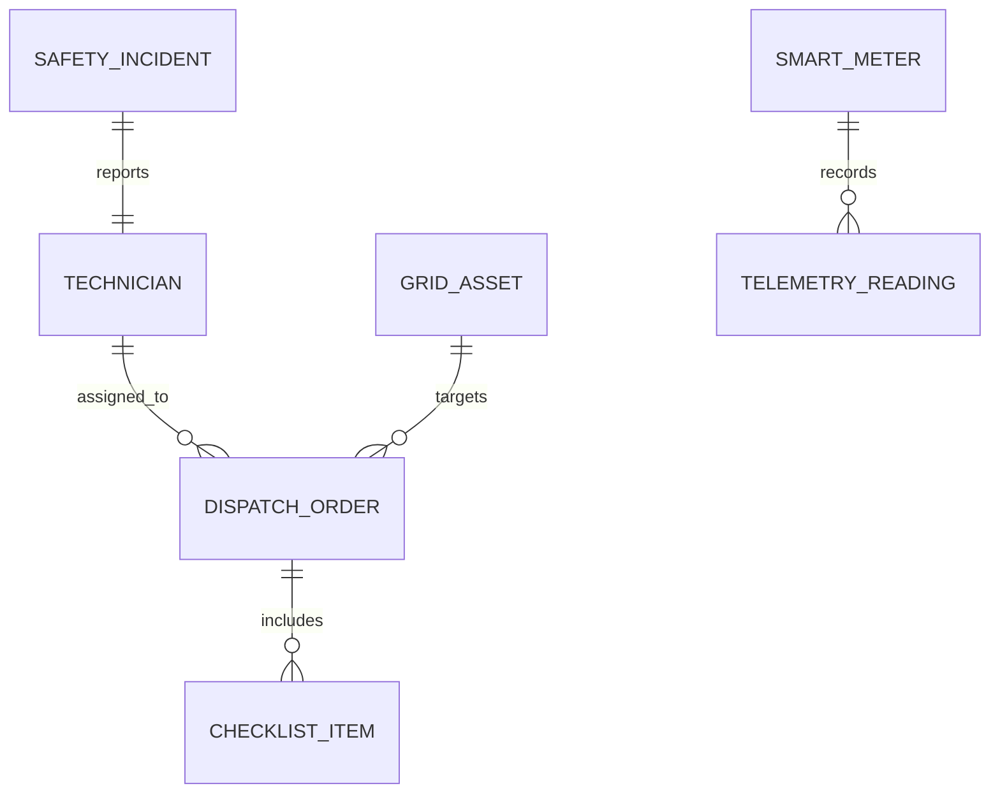

# 06 - Enterprise Energy & Field Utility Operations (Company-to-Employee Workforce App)

## 1. Executive Summary & Industry Benchmark
- **Benchmarked Applications:** Schneider Electric EcoStruxure Field, GE Vernova Grid Solutions, Siemens Energy Field Service, PG&E Utility Crew Operations.
- **Core Mission:** Enterprise mobile companion connecting central utility dispatch headquarters with field electrical engineers, smart meter technicians, and substation maintenance teams. Features offline work orders, GIS transformer/grid maps, smart meter telemetry sync, safety lockout/tagout checklists, and hazard incident reporting.
- **Form Factors:** Ruggedized Android/iOS Mobile Tablets & Phones, Central Dispatch Web Dashboard.

---

## 2. Functional Domains & Key User Journeys
1. **Work Order Dispatch & Offline Execution:**
   - Field technician receives assigned scheduled maintenance and emergency outage dispatch jobs.
   - 100% offline-first execution: complete tasks in remote sub-stations with zero cellular coverage; auto-sync via outbox queue upon network reconnection.
2. **GIS Grid & Asset Mapping:**
   - Vector offline maps showing high-voltage transmission lines, transformers, sub-stations, and smart meters with status pins (Nominal, Warning, Outage).
   - Turn-by-turn routing to utility pole coordinates.
3. **Safety Lockout/Tagout (LOTO) & Hazard Checklists:**
   - Mandatory OSHA / regulatory safety checklists before energizing or de-energizing circuits.
   - Photo proof requirement with mandatory geostamp and timestamp before job completion.
4. **Smart Meter Telemetry & Diagnostic Probing:**
   - Bluetooth Low Energy (BLE) / Optical probe pairing with industrial meters to read voltage, load profile, tamper logs, and firmware state.
   - Remote connect/disconnect actuation commands with supervisor approval codes.
5. **Shift Rostering & Emergency SOS:**
   - Lone-worker safety check-in timer (e.g., must ping every 30 minutes; triggers dispatcher alert if unresponsive).
   - Emergency panic SOS button transmitting live GPS coordinates to control room.

---

## 3. Domain Model & Key Attributes



### Key Attributes
- **TechnicianEmployee:** `employeeId`, `badgeNumber`, `skillsCertified` (e.g. `HIGH_VOLTAGE_LV4`, `FIBER_SPLICING`), `assignedDepotId`, `shiftStatus` (ON_DUTY | TRANSIT | ON_SITE | OFF_DUTY), `currentGpsCoords`.
- **WorkOrder:** `orderId`, `assetId`, `severity` (ROUTINE | P1_CRITICAL_OUTAGE | HAZARD), `status` (ASSIGNED | ACCEPTED | EN_ROUTE | WORK_IN_PROGRESS | COMPLETED | ESCALATED), `scheduledStartUtc`, `slaDeadlineUtc`, `lotoChecklistCompleted`.
- **GridAsset:** `assetId`, `assetType` (SUBSTATION | TRANSFORMER | FEEDER_PILLAR | POLE_MOUNT), `lat`, `lng`, `serialNumber`, `installedCapacityKva`, `operatingHealthScore`.
- **MeterTelemetryLog:** `meterId`, `timestampUtc`, `activePowerKwh`, `reactivePowerKvarh`, `voltagePhaseA`, `voltagePhaseB`, `voltagePhaseC`, `tamperEventCode`.

---

## 4. TypeScript DTOs & Contracts

```typescript
export type WorkOrderSeverity = 'ROUTINE' | 'ELEVATED' | 'CRITICAL_OUTAGE';
export type WorkOrderStatus = 'ASSIGNED' | 'EN_ROUTE' | 'IN_PROGRESS' | 'COMPLETED' | 'CANCELLED';

export interface WorkOrderDetailDto {
  orderId: string;
  asset: {
    assetId: string;
    name: string;
    type: string;
    coordinates: { lat: number; lng: number };
    address: string;
  };
  severity: WorkOrderSeverity;
  status: WorkOrderStatus;
  instructions: string;
  slaDeadline: string;
  safetyPrerequisites: Array<{ id: string; stepTitle: string; requiresPhotoProof: boolean }>;
  telemetrySnapshot?: {
    lastVoltage: number;
    powerFactor: number;
    faultCode?: string;
  };
}

export interface CompleteWorkOrderRequestDto {
  orderId: string;
  technicianId: string;
  completedAtUtc: string;
  resolutionSummary: string;
  partsReplaced: Array<{ partSku: string; quantity: number }>;
  safetySignoffSignatureUrl: string;
  photoEvidenceUrls: string[];
  offlineGeneratedGuid: string;
}

export interface SmartMeterBleSyncDto {
  meterSerialNumber: string;
  bleMacAddress: string;
  diagnosticPayload: {
    voltage: number;
    currentAmperes: number;
    frequencyHz: number;
    tamperDetected: boolean;
  };
}
```

---

## 5. UI Components Catalog (`@internal/ui-kit`)
1. `GisAssetMapViewer`: Mapbox/Google Maps integration with custom geoJSON layers displaying electrical grid topologies and asset health color coding.
2. `SafetyChecklistStepSheet`: Multi-step form enforcing camera photo capture and digital stylus signature before enabling the "Energize Circuit" toggle.
3. `BluetoothMeterProbeCard`: Pairing widget scanning for nearby DLMS/COSEM optical meters with live signal strength and data sync progress.
4. `LoneWorkerSafetyBar`: Persistent top header showing countdown timer for next mandatory check-in with high-contrast amber/red warning states.
5. `OfflineQueueSyncBadge`: Status indicator indicating how many field reports, photos, and meter readings are pending local SQLite outbox upload.

---

## 6. BFF & Microservices Architecture
- **Workforce Dispatch & Routing Service:** Schedules and assigns jobs using genetic algorithms or vehicle routing optimization to minimize field travel time.
- **SCADA & Grid Telemetry Bridge:** Ingests live substation telemetry via MQTT / OPC-UA and pushes real-time fault alerts to affected field crews.
- **Offline Sync & Conflict Resolution Gateway:** Handles batched binary uploads of photos and work order data with deterministic timestamp reconciliation.
- **Asset Lifecycle Management (EAM):** Interfaces with enterprise SAP PM / IBM Maximo backends for parts inventory tracking and equipment maintenance history.
