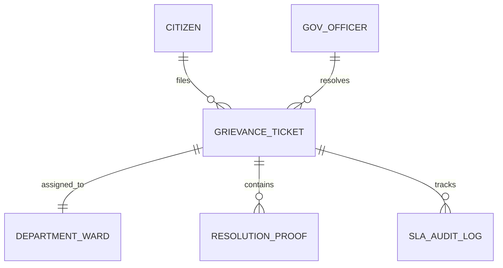

# 07 - Public Sector Citizen Grievance & Municipal Resolution Platform (GovTech 311)

## 1. Executive Summary & Industry Benchmark
- **Benchmarked Applications:** NYC 311, Swachhata App (Ministry of Housing & Urban Affairs), FixMyStreet (UK), Boston 311.
- **Core Mission:** Dual-sided civic engagement ecosystem enabling citizens to report civic, infrastructure, environmental, and municipal issues with geo-tagged media proof, track status in real-time, and receive updates; paired with an authorized Government Officer & Field Municipal Worker app to triage, inspect, resolve, and close grievances within mandated citizen charters (SLAs).
- **Form Factors:** Citizen Mobile App (iOS/Android), Officer Field App (iOS/Android), Municipal Ward Admin Portal.

---

## 2. Functional Domains & Key User Journeys

### Citizen Journey
1. **Civic Issue Reporting:**
   - Categories: Potholes, Road Cave-ins, Garbage Dumps, Dead Streetlights, Water Contamination, Illegal Encroachments, Stray Animal Menace.
   - GPS auto-location pinning with address reverse-geocoding.
   - Live camera photo/video capture with embedded timestamp and anti-tamper watermark.
2. **Real-Time Ticket Tracking & Milestones:**
   - Status pipeline: `Submitted` ➔ `Assigned to Ward Engineer` ➔ `Contractor Dispatched` ➔ `Work in Progress` ➔ `Resolved with Photo Evidence`.
   - Citizen push notifications at every state transition.
3. **Citizen Verification & Re-open / Feedback:**
   - Citizen inspects before-and-after photo proof.
   - Citizen can mark as "Satisfied" (rating 1-5) or "Re-open" within 72 hours if unresolved.

### Government Officer & Field Worker Journey
1. **Ward Triage & Automated Department Routing:**
   - AI/ML categorization of grievance photo into the appropriate department (e.g. Solid Waste, Roads & Bridges, Electrical, Water & Sewerage).
   - Dynamic SLA timer countdown based on severity (e.g. Broken Water Main = 4h SLA; Pothole = 48h SLA).
2. **Field Inspection & Contractor Assignment:**
   - Officer visits site using GPS navigation, inspects ground reality, assigns junior field crew or contractor.
3. **Resolution & Photographic Closure:**
   - Mandatory "After" photo taken at the exact GPS coordinates (within 50 meters geofence of original issue) to prevent fraudulent closures.

---

## 3. Domain Model & Key Attributes



### Key Attributes
- **GrievanceTicket:** `ticketId` (e.g. `GRV-2026-9812`), `citizenId`, `category` (ROADS | WATER | SANITATION | ELECTRICITY | NOISE), `description`, `lat`, `lng`, `landmark`, `photoUrls`, `status` (SUBMITTED | TRIAGED | IN_PROGRESS | RESOLVED | REOPENED | ESCALATED), `slaDeadlineUtc`, `assignedOfficerId`, `wardNumber`.
- **GovOfficer:** `officerId`, `designation` (WARD_ENGINEER | JUNIOR_INSPECTOR | CHIEF_COMMISSIONER), `departmentId`, `wardNumber`, `activeAssignedTicketsCount`, `slaCompliancePercentage`.
- **ResolutionProof:** `proofId`, `ticketId`, `resolvedByOfficerId`, `resolvedPhotoUrl`, `resolutionNotes`, `resolvedLat`, `resolvedLng`, `resolvedTimestampUtc`, `geofenceVerificationPassed`.
- **CitizenRatingFeedback:** `ticketId`, `ratingStars` (1-5), `comment`, `isReopened`.

---

## 4. TypeScript DTOs & Contracts

```typescript
export type GrievanceCategory = 'ROADS' | 'SANITATION' | 'WATER_SUPPLY' | 'ELECTRICAL' | 'PUBLIC_HEALTH';
export type TicketLifecycleState = 'PENDING_TRIAGE' | 'ASSIGNED' | 'IN_PROGRESS' | 'RESOLVED' | 'CLOSED' | 'REOPENED';

export interface SubmitGrievanceRequestDto {
  category: GrievanceCategory;
  description: string;
  location: {
    latitude: number;
    longitude: number;
    formattedAddress: string;
    wardZone?: string;
  };
  photoAttachmentUrls: string[];
  citizenContact: {
    name: string;
    phone: string;
    isAnonymous: boolean;
  };
}

export interface GrievanceTimelineResponseDto {
  ticketId: string;
  status: TicketLifecycleState;
  slaDeadline: string;
  slaStatus: 'ON_TRACK' | 'AT_RISK' | 'BREACHED';
  assignedDepartment: string;
  assignedOfficerName?: string;
  beforePhotos: string[];
  afterPhotos?: string[];
  history: Array<{
    state: TicketLifecycleState;
    timestamp: string;
    remarks: string;
    actorRole: 'CITIZEN' | 'OFFICER' | 'SYSTEM';
  }>;
}

export interface ResolveTicketOfficerDto {
  ticketId: string;
  officerId: string;
  resolutionRemarks: string;
  afterPhotoUrl: string;
  officerCoordinates: { latitude: number; longitude: number };
  contractorWorkOrderRef?: string;
}
```

---

## 5. UI Components Catalog (`@internal/ui-kit`)
1. `GrievanceCaptureCamera`: Camera module with persistent HUD overlay showing real-time GPS coordinates, compass bearing, and street address watermark.
2. `SlaCountDownTimerBadge`: Color-shifting badge (Green > Amber > Red Pulse) indicating remaining hours before SLA breach.
3. `BeforeAfterPhotoComparator`: Interactive swipe-slider component comparing the original citizen complaint image with the resolved municipal fix.
4. `WardHeatmapOverview`: Geospatial choropleth map grouping open grievances by municipal ward zones with severity color coding.
5. `DepartmentalRouteSelector`: Dropdown modal categorizing civic problems into municipal administrative directorates.

---

## 6. BFF & Microservices Architecture
- **Civic Ingestion & Triage Service:** Ingests citizen reports and automatically calculates ward jurisdiction using GeoJSON polygon boundaries.
- **AI Vision Triage Pipeline:** Pre-screens uploaded photos for duplicate complaints (e.g. 5 citizens reporting the same fallen tree) and clusters them into a single primary ticket.
- **Geofence Audit Validator:** Compares officer camera coordinates against original ticket coordinates to mathematically verify on-site presence.
- **Citizen Communication SMS/WhatsApp Gateway:** Sends localized SMS / WhatsApp notifications to citizens in regional languages (English, Hindi, Marathi, etc.) at each milestone.
