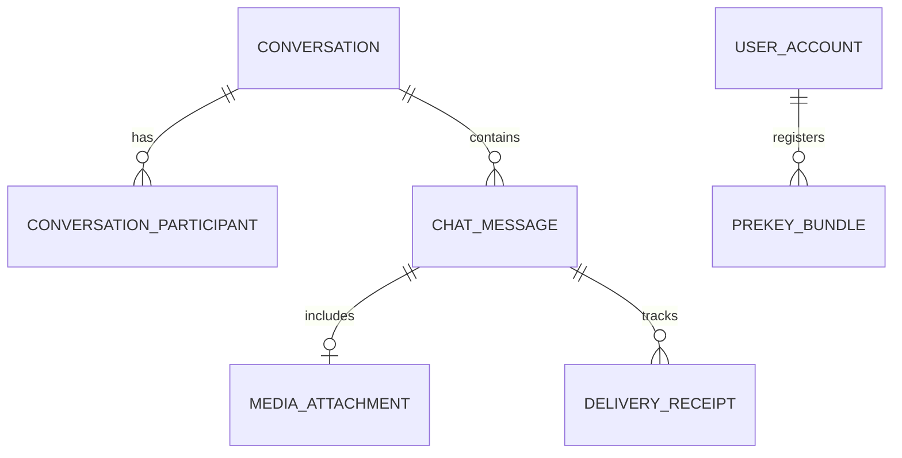

# 08 - Real-Time Communication & Messaging Platform (WhatsApp / Instagram Direct)

## 1. Executive Summary & Industry Benchmark
- **Benchmarked Applications:** WhatsApp, Instagram Direct, Telegram, Signal.
- **Core Mission:** Ultra-low latency, peer-to-peer and group encrypted real-time messaging with instant delivery receipts, ephemeral media ("view once"), audio voice notes, typing indicators, presence status, multi-device synchronization, and offline-first message spooling.
- **Form Factors:** Mobile (iOS/Android), Web / Desktop companion app.

---

## 2. Functional Domains & Key User Journeys
1. **Real-Time 1:1 & Group Conversations:**
   - WebSockets / MQTT persistent channels with sub-100ms message delivery.
   - Message status states: `Clock` (local outbox) ➔ `Single Grey Tick` (sent to server) ➔ `Double Grey Tick` (delivered to device) ➔ `Double Blue Tick` (read by recipient).
2. **End-to-End Encryption (E2EE):**
   - Signal Protocol double-ratchet key exchange; zero plaintext stored on server databases.
   - Public pre-key bundle rotation and identity verification safety numbers.
3. **Audio Voice Notes & Waveform Scrubber:**
   - Hold-to-record voice notes with sliding lock mechanism, live audio amplitude visualizer, and playback speed toggle (1x, 1.5x, 2x).
4. **Rich Media Sharing & Client-Side Compression:**
   - Client-side image/video compression (WebP / H.264 HEVC) before upload.
   - BlurHash placeholder instant rendering before full image download.
   - "View Once" self-destructing media with screenshot deterrents.
5. **Presence & Typing Indicator Broadcast:**
   - Ephemeral Redis-backed typing indicator throttled to 2-second heartbeats.
   - Configurable privacy controls for "Last Seen" and "Online" status.

---

## 3. Domain Model & Key Attributes



### Key Attributes
- **Conversation:** `conversationId`, `type` (DIRECT | GROUP | CHANNEL), `title`, `avatarUrl`, `adminUserIds`, `disappearingTimerSeconds`, `createdAtUtc`.
- **ChatMessage:** `messageId`, `clientGeneratedNonce`, `conversationId`, `senderId`, `cipherPayload`, `messageType` (TEXT | AUDIO | IMAGE | VIDEO | DOCUMENT | CONTACT), `replyToMessageId`, `status` (QUEUED | SENT | DELIVERED | READ), `sentAtUtc`.
- **MediaAttachment:** `attachmentId`, `s3KeyEncrypted`, `blurhash`, `mimeType`, `fileSizeBytes`, `durationSeconds` (for audio/video), `waveformBars` (array of float amplitudes).
- **DeliveryReceipt:** `messageId`, `recipientId`, `status` (DELIVERED | READ), `timestampUtc`.

---

## 4. TypeScript DTOs & Contracts

```typescript
export type MessageKind = 'TEXT' | 'VOICE_NOTE' | 'IMAGE' | 'VIDEO' | 'SYSTEM_ALERT';
export type DeliveryTickStatus = 'OUTBOX' | 'SENT_SERVER' | 'DELIVERED_DEVICE' | 'READ_BY_USER';

export interface SendMessageRequestDto {
  conversationId: string;
  clientNonce: string;
  kind: MessageKind;
  encryptedContent: string;
  replyToMessageId?: string;
  mediaMeta?: {
    encryptedAssetUrl: string;
    encryptionKeyIv: string;
    blurhash: string;
    fileSizeBytes: number;
    durationMs?: number;
    waveformSamples?: number[];
  };
}

export interface MessageEnvelopeDto {
  messageId: string;
  clientNonce: string;
  conversationId: string;
  senderId: string;
  kind: MessageKind;
  encryptedContent: string;
  timestamp: string;
  deliveryStatus: DeliveryTickStatus;
  mediaMeta?: Record<string, any>;
}

export interface TypingPresenceEventDto {
  conversationId: string;
  userId: string;
  isTyping: boolean;
  timestamp: number;
}
```

---

## 5. UI Components Catalog (`@internal/ui-kit`)
1. `ChatBubble`: Adaptive message bubble with rounded corners, tail direction, timestamp, double blue tick status icon, and long-press contextual reaction menu.
2. `AudioVoiceNotePlayer`: Waveform bar visualizer with sliding scrub handle, playback speed pill (1x / 1.5x / 2x), and proximity sensor ear-piece speaker toggle.
3. `VoiceRecordHoldButton`: Drag-up to lock, drag-left to cancel recording button with pulsing red recording indicator.
4. `MessageInputBar`: Auto-expanding multiline text field with emoji picker drawer, paperclip attachment menu, and camera quick-launch.
5. `BlurhashImageThumbnail`: Lightweight progressive image viewer that instantly displays low-resolution blurhash before decrypted image renders.

---

## 6. BFF & Microservices Architecture
- **Real-Time Gateway (WebSocket / Socket.io / MQTT):** Horizontally scalable cluster with Redis Pub/Sub adapter handling millions of concurrent user sockets.
- **Signal Protocol Key Service:** Distributes pre-key bundles and signed identity keys without storing private encryption keys.
- **Offline Message Buffer Queue:** RabbitMQ / Redis Streams queue retaining unacknowledged messages for offline devices, flushing immediately upon socket handshake.
- **Ephemeral Media S3 Lifecycle Worker:** Automated cleanup routine deleting "View Once" media and expired attachments after specified retention limits.
