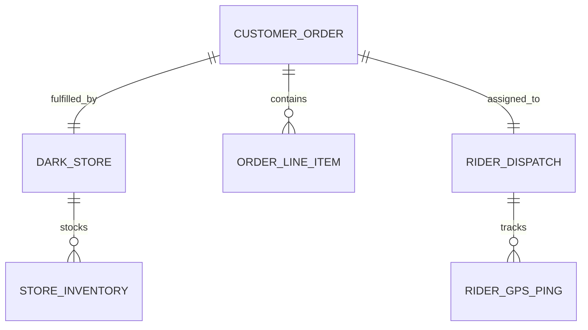

# 09 - Hyper-Local Quick Commerce & Delivery Platform (Blinkit / Instamart / Zepto)

## 1. Executive Summary & Industry Benchmark
- **Benchmarked Applications:** Blinkit, Swiggy Instamart, Zepto, DoorDash DashMart, Getir.
- **Core Mission:** Sub-10-minute instant delivery ecosystem operating out of micro-fulfillment "dark stores". Features sub-second geofenced store mapping, temporary inventory reservation locks during checkout, dark store picker-packer dispatch workflows, live high-frequency rider GPS telemetry, and secure OTP handovers.
- **Form Factors:** Consumer Mobile App (iOS/Android), Dark Store Picker App, Delivery Rider Partner App.

---

## 2. Functional Domains & Key User Journeys
1. **Micro-Fulfillment Dark Store Mapping:**
   - Geolocation automatically binds consumer to the nearest dark store within a 2.5 km radius.
   - Dynamic delivery promise banner ("Delivering in 8 mins to Flat 402").
   - Out-of-service / rainy weather surge notification and dynamic delivery fee surcharge.
2. **Flash Cart & Inventory Reservation Lock:**
   - Real-time stock counts (e.g. "Only 2 left in stock").
   - 7-minute inventory reservation hold when entering checkout; released automatically if payment is abandoned.
3. **Dark Store Picker & Packer Orchestration:**
   - Dark store app organizes order into aisle-shelf picking routes.
   - Barcode scanning of items to verify correct brand, weight, and expiry date.
   - Bag sealing and placement in outbound staging rack.
4. **Live Rider Dispatch & Telemetry Tracking:**
   - Algorithm dispatches nearest rider to dark store before packing finishes.
   - WebSocket / MQTT live GPS location stream updating customer map every 3 seconds.
   - Real-time ETA recalculation factoring traffic and weather.
5. **Contactless / OTP Handover:**
   - 4-digit verification OTP or door-drop photo proof before completing order.

---

## 3. Domain Model & Key Attributes



### Key Attributes
- **DarkStore:** `storeId`, `name`, `polygonGeofence`, `status` (OPEN | HIGH_LOAD | CLOSED), `averagePickingTimeSec`, `latitude`, `longitude`.
- **StoreInventory:** `skuId`, `storeId`, `stockPhysicalCount`, `stockReservedCount`, `shelfLocation` (e.g. `AISLE_3_BIN_12`), `isAvailable`.
- **QuickOrder:** `orderId`, `customerId`, `storeId`, `orderStatus` (PLACED | PICKING | PACKED | OUT_FOR_DELIVERY | DELIVERED | CANCELLED), `deliveryAddress`, `otpCode`, `deliveryEtaUtc`, `totalAmount`.
- **RiderDispatch:** `dispatchId`, `orderId`, `riderId`, `riderName`, `riderPhone`, `riderLat`, `riderLng`, `riderBearingDegrees`, `batteryLevelPercentage`.

---

## 4. TypeScript DTOs & Contracts

```typescript
export type QuickOrderStatus = 'ORDER_CONFIRMED' | 'PACKING_IN_STORE' | 'RIDER_ASSIGNED' | 'OUT_FOR_DELIVERY' | 'DELIVERED';

export interface DarkStoreAvailabilityDto {
  storeId: string;
  isServiceable: boolean;
  estimatedDeliveryMinutes: number;
  surgePricingActive: boolean;
  surgeDeliveryFee: number;
}

export interface ReserveCartInventoryRequestDto {
  storeId: string;
  cartItems: Array<{ skuId: string; quantity: number }>;
  userId: string;
}

export interface ReserveCartInventoryResponseDto {
  reservationId: string;
  reservationExpiresAt: string; // 7 minutes from now
  isSuccessful: boolean;
  unavailableSkus?: string[];
}

export interface RiderLiveTrackingDto {
  orderId: string;
  riderId: string;
  coordinates: { latitude: number; longitude: number };
  headingBearing: number;
  speedKmh: number;
  currentEtaMinutes: number;
  deliveryPolylinePoints: string; // Encoded polyline
  handoverOtpRequired: boolean;
}
```

---

## 5. UI Components Catalog (`@internal/ui-kit`)
1. `DeliveryEtaPillHeader`: Prominent top bar displaying real-time delivery countdown ("Delivering in 8 mins") with a lightning icon and store status.
2. `LiveRiderMapViewer`: Smooth Mapbox vector map displaying dark store origin, rider delivery bike icon rotating with device heading, and customer destination pin.
3. `FlashCartSummaryBar`: Bottom floating bar showing item count, total price, and "Proceed to Pay" button with 7-minute reservation countdown timer.
4. `OtpHandoverCard`: High-contrast 4-digit numeric code card with button to copy or show rider.
5. `StoreInventoryOutOfStockSheet`: Bottom drawer suggesting instant replacements for items that went out of stock during shopping.

---

## 6. BFF & Microservices Architecture
- **Geospatial Store Routing Service:** High-speed spatial indexing (using Uber H3 or S2 geometry) to determine dark store coverage in under 5ms.
- **Inventory Reservation Manager:** Redis Lua-scripted distributed counter decrementing stock atomically and setting a 7-minute TTL expiration key.
- **Picker Optimization Engine:** Algorithmic warehouse management system (WMS) sorting order items into shortest physical path through store aisles.
- **Rider GPS Stream Ingest:** High-throughput MQTT ingestion pipeline buffering rider location pings and broadcasting smoothed map updates over WebSockets.
