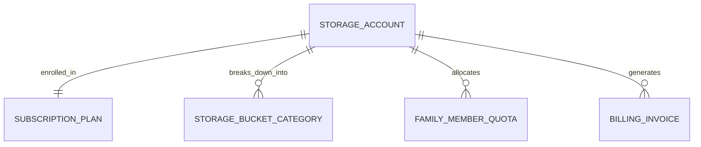

# 10 - Cloud Storage & Tiered Subscription Quota Management (Google One / iCloud / Dropbox)

## 1. Executive Summary & Industry Benchmark
- **Benchmarked Applications:** Google One, Apple iCloud+, Dropbox, Microsoft OneDrive.
- **Core Mission:** Granular storage quota allocation and monitoring system paired with multi-tier recurring subscription billing. Features storage breakdown visualizations (Photos, Videos, Drive, Mail, Device Backups), duplicate file detection & cleanup, upgrade/downgrade proration, and app store receipt validation (StoreKit 2 / Google Play Billing / Stripe).
- **Form Factors:** Mobile (iOS/Android), Desktop/Web Client, System Tray Companion.

---

## 2. Functional Domains & Key User Journeys
1. **Real-Time Storage Consumption Telemetry:**
   - Visual gauge showing total bytes used vs total quota limit.
   - Categorized breakdown: Media (Photos/Videos), Documents, Backups, Cache, Trash Bin.
   - Warning banners at 80% and 95% storage thresholds.
2. **Storage Cleanup & Space Saver Tools:**
   - Automated detection of duplicate files, blurry photos, and large files (> 100MB).
   - "Free up 4.2 GB" single-click smart cleanup action.
3. **Tiered Subscription Plans & Paywall:**
   - Free (15 GB) ➔ Basic (100 GB @ $1.99/mo) ➔ Standard (200 GB @ $2.99/mo) ➔ Premium (2 TB @ $9.99/mo).
   - Family sharing toggle: distribute a single 2 TB pool across up to 5 family members with zero private file visibility.
4. **Billing Lifecycle & Proration:**
   - Monthly and annual billing cycles with discounted annual pricing.
   - Upgrade proration (immediate storage quota expansion; credit balance applied).
   - Downgrade handling (plan changes take effect at next billing cycle; grace period if user usage exceeds new lower quota).
5. **Multi-Store In-App Purchase Validation:**
   - Unified subscription entitlement layer verifying Apple StoreKit 2 JWS transactions, Google Play Billing RTDN (Real-Time Developer Notifications), and Stripe Webhooks.

---

## 3. Domain Model & Key Attributes



### Key Attributes
- **StorageAccount:** `accountId`, `userId`, `totalQuotaBytes` (e.g. 2,147,483,648,000 for 2TB), `usedBytesTotal`, `isGracePeriodActive`, `gracePeriodExpiryUtc`.
- **SubscriptionPlan:** `planId`, `tierName` (FREE | BASIC_100GB | STANDARD_200GB | PREMIUM_2TB), `storageBytesLimit`, `monthlyPriceUsd`, `annualPriceUsd`, `familySharingAllowed`.
- **StorageCategoryUsage:** `accountId`, `category` (PHOTOS | VIDEOS | DOCUMENTS | SYSTEM_BACKUPS | TRASH), `usedBytes`, `fileCount`.
- **BillingInvoice:** `invoiceId`, `accountId`, `paymentProvider` (APPLE_IAP | GOOGLE_PLAY | STRIPE), `originalTransactionId`, `periodStartUtc`, `periodEndUtc`, `status` (PAID | PAST_DUE | CANCELLED).

---

## 4. TypeScript DTOs & Contracts

```typescript
export type StorageCategoryType = 'PHOTOS' | 'VIDEOS' | 'DOCUMENTS' | 'BACKUPS' | 'TRASH';

export interface StorageUsageSummaryDto {
  accountId: string;
  totalQuotaBytes: number;
  usedBytes: number;
  freeBytes: number;
  percentageUsed: number;
  isOverQuota: boolean;
  categories: Array<{
    category: StorageCategoryType;
    usedBytes: number;
    colorHex: string;
    percentageOfUsed: number;
  }>;
  currentPlan: {
    planId: string;
    name: string;
    billingCycle: 'MONTHLY' | 'ANNUAL';
    renewalDate: string;
  };
}

export interface CleanupRecommendationDto {
  recommendationType: 'DUPLICATE_FILES' | 'LARGE_VIDEOS' | 'SCREENSHOTS' | 'TRASH_BIN';
  potentialBytesSaved: number;
  fileCount: number;
  sampleItems: Array<{ id: string; name: string; sizeBytes: number; previewUrl?: string }>;
}

export interface UpgradeSubscriptionRequestDto {
  targetPlanId: string;
  billingPeriod: 'MONTHLY' | 'ANNUAL';
  paymentReceiptPayload: {
    provider: 'APPLE_STOREKIT' | 'GOOGLE_PLAY' | 'STRIPE';
    receiptOrPurchaseToken: string;
    productId: string;
  };
}
```

---

## 5. UI Components Catalog (`@internal/ui-kit`)
1. `StorageDonutGauge`: High-precision animated circular progress ring or multi-segmented stacked horizontal bar showing colored breakdown of Photos, Videos, Documents, and Free Space.
2. `SubscriptionPlanComparisonCard`: Flip or carousel card displaying plan benefits (Storage limit, VPN, Gold support, Family share) with "Upgrade Plan" CTA.
3. `CleanupActionTile`: Card showing "Clean up 2.4 GB of large videos" with a prominent action button and expandable item list.
4. `BillingStatusBanner`: Warning banner highlighting expired credit cards, grace period countdowns, or pending sync pauses due to quota exhaustion.
5. `FamilyQuotaAllocationSlider`: Slider component allowing the account manager to cap or grant pooled storage allocations per family member.

---

## 6. BFF & Microservices Architecture
- **Storage Telemetry & Quota Service:** Maintains cached Redis counters updated via S3 / Cloud Storage object creation/deletion webhooks to avoid expensive DB recalculations.
- **Subscription Entitlement Gateway:** Centralized server-side validator for StoreKit 2 signed JWS tokens, Google Play Developer API, and Stripe Webhook events.
- **Deduplication & Indexing Worker:** Background BullMQ job analyzing file checksums (SHA-256) and perceptual image hashes to detect redundant files.
- **Notification & Grace Period Manager:** Sends escalating email and push notifications at 80%, 90%, 100%, and 105% quota consumption, managing 30-day grace periods before read-only lock.
