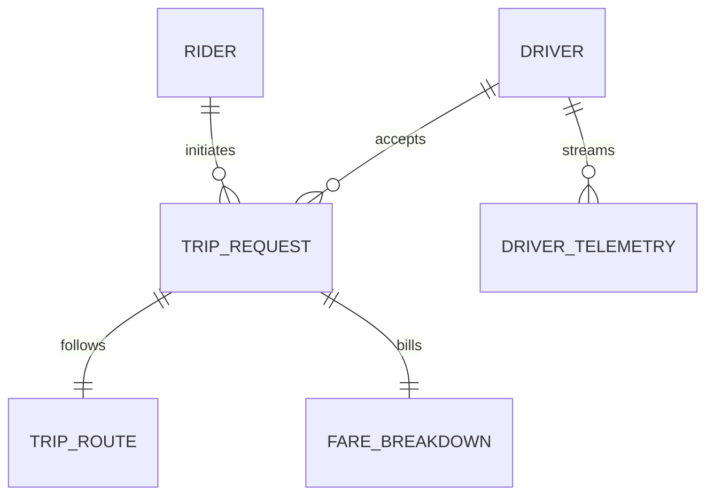

# 11 - Smart Mobility & On-Demand Ride-Hailing Platform (Uber / Ola / Lyft)

## 1. Executive Summary & Industry Benchmark
- **Benchmarked Applications:** Uber, Ola, Lyft, Grab.
- **Core Mission:** Real-time dual-party transportation network connecting riders with drivers. Features geohash-based spatial driver matching, real-time dynamic surge pricing, GPS polyline navigation with live traffic recalculation, split-fare routing, and in-ride safety SOS telemetry.
- **Form Factors:** Rider Mobile App (iOS/Android), Driver Partner App (iOS/Android), Fleet Operations Dispatch Portal.

---

## 2. Functional Domains & Key User Journeys
1. **Ride Booking & Fare Estimation:**
   - Pickup & destination autocomplete with geocoding.
   - Tiered vehicle selection: Economy, Comfort, XL, Moto, Auto.
   - Upfront guaranteed fare calculation factoring distance, traffic duration, and surge multiplier.
2. **Real-Time Driver Matching & Dispatch:**
   - Geospatial proximity query (Uber H3 hex resolution 7-8) locating available drivers within a 3km polygon.
   - Round-robin or auction-style dispatch broadcast with 15-second driver acceptance countdown.
3. **Turn-by-Turn Navigation & Ride Progress:**
   - Driver navigation with route polyline, live turn instructions, and congestion re-routing.
   - Rider view displaying driver car icon smoothly animated along polyline towards pickup.
4. **Safety Toolkit & Telemetry Monitoring:**
   - Ride PIN verification: driver cannot start trip until rider provides 4-digit PIN.
   - RideCheck anomaly detection: detects unexpected stops, sudden deviations from route, or high deceleration (crash detection).
   - In-app 911 / Police SOS trigger sharing live telemetry URL with emergency services.
5. **Post-Trip Settlement & Dynamic Tipping:**
   - Toll and waiting fee auto-calculation.
   - Split fare with co-passengers.
   - Two-way mutual rating & feedback (Rider rates Driver, Driver rates Rider).

---

## 3. Domain Model & Key Attributes



### Key Attributes
- **RiderProfile:** `riderId`, `ratingAverage`, `savedAddresses` (Home, Work), `preferredPaymentMethodId`, `emergencyContacts`.
- **DriverPartner:** `driverId`, `vehicleDetails` (Model, Color, LicensePlate, Tier), `driverRatingAverage`, `currentStatus` (OFFLINE | SEARCHING | EN_ROUTE_PICKUP | ON_TRIP), `currentLat`, `currentLng`, `currentBearing`.
- **TripRequest:** `tripId`, `riderId`, `driverId`, `status` (REQUESTED | MATCHED | DRIVER_ARRIVED | TRIP_ACTIVE | COMPLETED | CANCELLED), `pickupCoords`, `destinationCoords`, `startOtpPin`, `fareAmount`, `surgeMultiplier`, `startedAtUtc`, `endedAtUtc`.
- **FareBreakdown:** `tripId`, `baseFare`, `distanceFare`, `timeFare`, `surgeCharge`, `tollsAndTaxes`, `tipAmount`, `currencyCode`.

---

## 4. TypeScript DTOs & Contracts

```typescript
export type VehicleTier = 'MOTO' | 'AUTO' | 'SEDAN_ECONOMY' | 'PREMIUM_XL';
export type TripLifecycleStatus = 'SEARCHING_DRIVER' | 'DRIVER_ACCEPTED' | 'DRIVER_ARRIVED' | 'IN_TRANSIT' | 'COMPLETED';

export interface FareEstimateRequestDto {
  pickup: { lat: number; lng: number; address: string };
  dropoff: { lat: number; lng: number; address: string };
}

export interface FareEstimateOptionDto {
  tier: VehicleTier;
  estimatedFare: number;
  currency: string;
  surgeMultiplier: number; // e.g. 1.25x
  estimatedPickupMinutes: number;
  estimatedTripDurationMinutes: number;
  routePolyline: string;
}

export interface BookTripRequestDto {
  tier: VehicleTier;
  pickupLocation: { lat: number; lng: number; address: string };
  dropoffLocation: { lat: number; lng: number; address: string };
  paymentMethodId: string;
  idempotencyToken: string;
}

export interface ActiveTripStatusDto {
  tripId: string;
  status: TripLifecycleStatus;
  otpStartPin: string;
  driver?: {
    name: string;
    photoUrl: string;
    phone: string;
    rating: number;
    vehicleModel: string;
    vehiclePlateNumber: string;
    currentLocation: { lat: number; lng: number; bearing: number };
  };
  destination: { lat: number; lng: number; address: string };
  etaMinutes: number;
  polyline: string;
}
```

---

## 5. UI Components Catalog (`@internal/ui-kit`)
1. `RideMapInteractiveCanvas`: High-performance vector map with custom car marker rotation, pickup pulse animation, and polyline route coloring (green for clear, orange for moderate traffic, red for heavy traffic).
2. `VehicleTierSelectorCarousel`: Horizontal carousel showcasing 3D vehicle renders, estimated price, ETA, and seat capacity.
3. `TripStatusDrawerSheet`: Expandable bottom sheet displaying driver details, car license plate in large bold characters, calling/messaging action buttons, and Safety Toolkit button.
4. `OtpVerificationCodeBox`: High-visibility 4-digit code tile displayed prominently for rider to show driver.
5. `SafetyEmergencyButton`: Persistent floating shield icon launching safety toolkit (Share trip with contacts, Call police, Report route deviation).

---

## 6. BFF & Microservices Architecture
- **Geospatial Dispatch Engine:** Redis Geospatial & Uber H3 spatial index mapping live driver locations and executing radial k-nearest neighbor queries in sub-10ms.
- **Dynamic Pricing & Surge Engine:** Machine learning service calculating supply/demand elasticity per geohash cell to compute dynamic surge multipliers.
- **Routing & Navigation Engine:** Open Source Routing Machine (OSRM) or Google Maps Directions API proxy calculating optimal road navigation paths and realistic traffic ETAs.
- **Safety Telemetry Ingest (RideCheck):** Stream analytics processing continuous GPS and accelerometer feeds from rider/driver phones to detect crash spikes or anomalous stops.
