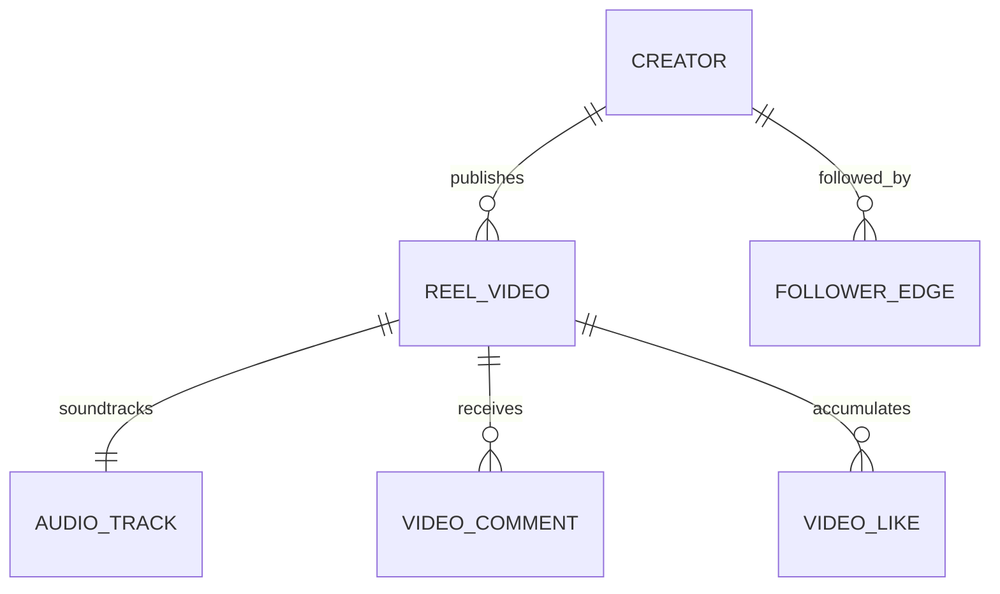

# 12 - Immersive Short-Form Video & Creator Feed (Instagram Reels / TikTok / YouTube Shorts)

## 1. Executive Summary & Industry Benchmark
- **Benchmarked Applications:** Instagram Reels, TikTok, YouTube Shorts.
- **Core Mission:** Ultra-responsive, full-screen vertical short-form video streaming platform with snap-pagination, sub-200ms video start latency, creator audio synchronization, double-tap floating heart animations, expandable threaded comment sheets, creator tipping, and algorithmic engagement telemetry.
- **Form Factors:** Mobile (iOS/Android), Creator Studio Web.

---

## 2. Functional Domains & Key User Journeys
1. **Infinite Vertical Snap-Feed:**
   - Seamless vertical swipe with viewport gesture physics (`pagingEnabled`).
   - Windowed buffer management: Keep current video playing, pre-cache the next 2 videos in memory, and pause/unload previous videos to prevent out-of-memory (OOM) crashes.
2. **Audio Track Licensing & Waveform Pill:**
   - Original audio vs. trending licensed music tracks.
   - Animated rotating vinyl disc icon and scrolling marquee audio title pill.
   - Tap to view all reels using the same audio snippet.
3. **Micro-Interactions & Social Engagement:**
   - Double-tap anywhere on video triggers a particle burst heart animation with haptic feedback.
   - Floating interactive right-sidebar: Heart count, Comment count, Bookmark/Save, Share sheet (WhatsApp/Instagram Direct), and Remix/Duet button.
4. **Expandable Threaded Comments Drawer:**
   - Non-blocking bottom sheet: Video continues playing in a scaled or blurred background while reading comments.
   - Real-time comment submission, emoji quick-reactions, and pinned creator comments.
5. **Creator Profiles & Follower Graph:**
   - 1-tap "Follow" button with optimistic state update.
   - Creator tipping / virtual gifting gateway.

---

## 3. Domain Model & Key Attributes



### Key Attributes
- **ReelVideo:** `reelId`, `creatorId`, `videoHlsUrl`, `videoMp4FallbackUrl`, `thumbnailUrl`, `aspectRatio` (9:16), `durationMs` (max 60,000ms), `caption`, `hashtags`, `audioTrackId`, `likeCount`, `commentCount`, `shareCount`, `viewCount`, `publishedAtUtc`.
- **AudioTrack:** `audioId`, `title`, `artistName`, `coverArtUrl`, `audioStreamUrl`, `durationSeconds`, `usageCount`.
- **VideoComment:** `commentId`, `reelId`, `userId`, `authorName`, `authorAvatarUrl`, `text`, `likeCount`, `parentCommentId`, `createdAtUtc`.
- **EngagementTelemetry:** `reelId`, `userId`, `watchDurationMs`, `completionRatio`, `loopCount`, `skippedUnder2Sec`, `interactedFlag`.

---

## 4. TypeScript DTOs & Contracts

```typescript
export interface ReelFeedItemDto {
  reelId: string;
  creator: {
    userId: string;
    username: string;
    avatarUrl: string;
    isVerified: boolean;
    isFollowing: boolean;
  };
  video: {
    manifestUrl: string; // HLS playlist
    fallbackUrl: string;
    thumbnailUrl: string;
    aspectRatio: number;
    durationMs: number;
  };
  audio: {
    audioId: string;
    title: string;
    artist: string;
    albumArtUrl: string;
  };
  caption: string;
  hashtags: string[];
  metrics: {
    likes: number;
    comments: number;
    shares: number;
    isLiked: boolean;
    isBookmarked: boolean;
  };
  publishedAt: string;
}

export interface ToggleReelLikeRequestDto {
  reelId: string;
  isLiked: boolean;
  clientTimestamp: number;
}

export interface AddCommentRequestDto {
  reelId: string;
  text: string;
  parentCommentId?: string;
}
```

---

## 5. UI Components Catalog (`@internal/ui-kit`)
1. `VerticalVideoPager`: High-performance gesture-driven virtualized vertical feed with windowed video players.
2. `FloatingActionSidebar`: Vertical stack of animated icons (Animated Heart with spring bounce, Comment bubble, Bookmark ribbon, Share paper plane, and Vinyl disk).
3. `DoubleTapHeartBurst`: GPU-accelerated particle animation rendering floating hearts at the exact coordinates of the double tap.
4. `AudioMarqueePill`: Scrolling marquee text displaying track title with musical note icon.
5. `CommentBottomSheet`: Gesture-dismissable bottom sheet with sticky input bar and virtualized comment thread.

---

## 6. BFF & Microservices Architecture
- **Recommendation & Feed Pipeline:** Redis-backed sorted set delivering personalized video feeds based on user interest vector embeddings and real-time completion telemetry.
- **Transcoding & CDN Ingestion:** AWS MediaConvert / ffmpeg worker generating multi-bitrate HLS chunk variants (1080p, 720p, 480p) optimized for cellular data.
- **Engagement Aggregator:** Kafka stream processing millions of likes, views, and completion pings, batch-updating PostgreSQL counters every 5 seconds.
