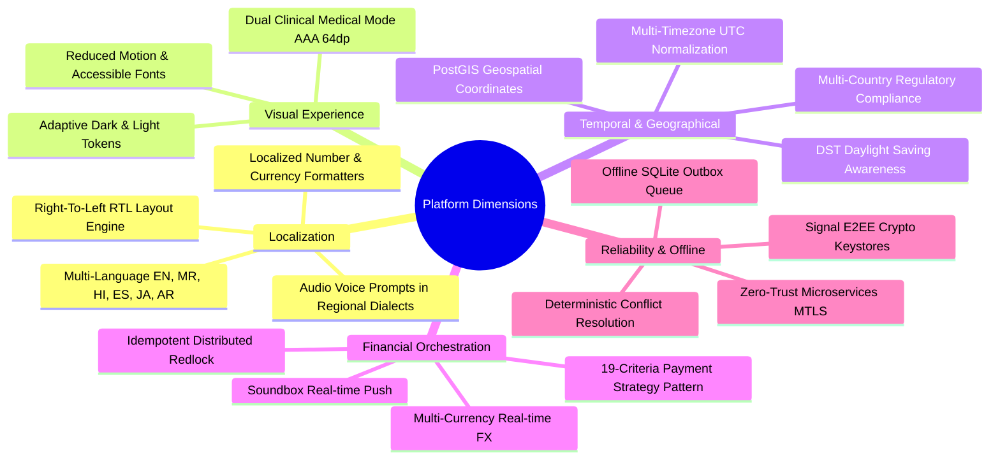
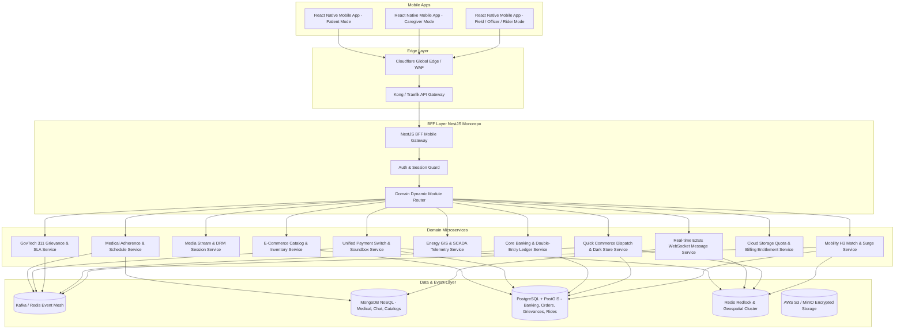

# GLOBAL ENTERPRISE ARCHITECTURE: MULTI-VERTICAL PLATFORM BLUEPRINT

> **Author:** Antigravity Principal Architecture Team  
> **Workspace:** `/Users/pratikshadoshi/RN-Stuff`  
> **Scope:** Cross-Vertical Unification across 11 Major Industry Applications  
> **Target Stack:** React Native (New Architecture: Fabric & TurboModules) + NestJS BFF + Distributed Microservices & Event Mesh

---

## 1. Executive Synthesis & Vertical Portfolio Matrix

To establish enterprise reusability and avoid siloed implementations, this platform blueprint unifies **11 distinct industry verticals** on top of our shared `@internal/*` library ecosystem. 

| # | Vertical | Benchmark Reference | Key Technical Challenge | Unique Edge Pattern |
|---|---|---|---|---|
| **01** | **Medical & Chronic Care** | NHS / Practo / Caregiver | Dual-Mode UI (Elderly AAA vs Caregiver), Exact Alarms | Offline local native alarm scheduler, Marathi/English bilingual |
| **02** | **E-Commerce & Fashion** | H&M, Zara, The Souled Store | Faceted catalog search, inventory locks, lookbooks | Optimistic cart reservation, multi-currency checkout |
| **03** | **Streaming Media** | Netflix, Disney+ Hotstar | Adaptive bitrate (HLS/DASH), DRM (FairPlay/Widevine) | Offline encrypted video segments, low-latency live overlay |
| **04** | **Digital Payments** | PhonePe, Google Pay, Venmo | Sub-second transaction switch, zero double-debit | Hardware MPIN keystore, MQTT merchant soundbox |
| **05** | **Core Banking** | Revolut, Chase, Monzo | Immutable double-entry general ledger, AML/KYC | Card controls (freeze/limits), cryptographic audit chain |
| **06** | **Enterprise Energy & Field** | Schneider Electric, GE Vernova | Remote GIS grid, smart meter BLE probing, safety LOTO | Offline SQLite outbox, mandatory geofenced photo audit |
| **07** | **Public Sector (GovTech 311)** | NYC 311, Swachhata, FixMyStreet | Dual-sided Citizen Grievance + Municipal Officer app | SLA countdown timers, geofenced after-photo verification |
| **08** | **Real-Time Encrypted Chat** | WhatsApp, Instagram Direct | E2EE Signal double-ratchet, audio waveforms | BlurHash placeholders, multi-device socket presence |
| **09** | **Quick Commerce Delivery** | Blinkit, Instamart, Zepto | Sub-10-minute dark store dispatch, live rider GPS | 7-minute inventory reservation, rider bearing smoothing |
| **10** | **Cloud Storage & Quotas** | Google One, iCloud, Dropbox | Granular byte telemetry, family quota pooling | In-app purchase entitlement engine (StoreKit 2 / Play) |
| **11** | **Smart Mobility & Logistics** | Uber, Ola, Lyft | H3 spatial driver matching, dynamic surge pricing | Real-time GPS polyline routing, RideCheck anomaly detection |

---

## 2. Global Monorepo Package Ecosystem (`packages/*`)

The monorepo structure guarantees that 80% of foundational mobile and server capabilities are shared across all 11 verticals:

```
RN-Stuff/
├── packages/
│   ├── contracts/          # Zod schemas, TypeScript DTOs, RPC contracts for all 11 domains
│   ├── config/             # Environment flags, feature-toggles, build flavors
│   ├── a11y/               # WCAG 2.1 AAA tokens, elderly patient mode, high-contrast themes
│   ├── i18n/               # Universal translation engine (EN, MR, HI, ES, FR, DE, JA, AR)
│   ├── network/            # Offline-first HTTP/WS client, idempotent retries, outbox queue
│   ├── auth/               # Biometric hardware keystore, OAuth2/OIDC, Signal E2EE keys
│   ├── storage/            # Encrypted MMKV & SQLite engine with AES-256-GCM
│   ├── ui-kit/             # Unified design system (55+ domain components + base primitives)
│   ├── payments/           # 19-criteria universal payment engine (Stripe, Razorpay, UPI, IAP)
│   ├── telemetry/          # Crash analytics, GPS background tracker, video playback metrics
│   ├── testing/            # Contract mocking, fixture generators, e2e test harnesses
│   └── server-kit/         # NestJS guards, interceptors, Kafka/Redis publishers, logger
└── apps/
    ├── bff-mobile/         # NestJS Backend-for-Frontend with domain sub-modules
    └── mobile/             # React Native cross-vertical client app
```

---

## 3. Total Catalog of New UI Components (`@internal/ui-kit`)

Our shared UI design system is organized into **Core Atoms** and **Domain Molecules**:

### 3.1. Core Base Primitives (Universal)
1. `AppButton` (Primary, Secondary, Ghost, High-Contrast AAA Elderly 64dp variant).
2. `AppInput` (Floating label, validation error badge, secure mask, oversized typography).
3. `AppModal` & `BottomSheet` (Spring animations, snap points, gesture dismissable).
4. `StatusBadge` (Pill badge supporting success, warning, critical, SLA breach).
5. `OfflineBanner` (Auto-animated top banner showing offline status and outbox count).

### 3.2. Domain-Specific Component Catalog

```mermaid
graph TD
    UI[ui-kit Component Catalog]
    UI --> MED[Medical: LargeAlarmCard, VoicePromptButton, AdherenceCalendar]
    UI --> ECOM[E-Commerce: FacetedFilterDrawer, LookbookCarousel, SizeAdvisor]
    UI --> STRM[Streaming: VideoPlayerControls, HeroBillboard, SubtitleSelector]
    UI --> PAY[Payments: CameraQrScanner, NumericKeypad, SuccessScratchCard]
    UI --> BNK[Banking: 3DFlipCard, SecurityToggleList, KycScannerOverlay]
    UI --> ENG[Energy: GisAssetMap, SafetyChecklistStepSheet, BluetoothProbeWidget]
    UI --> GOV[GovTech: GrievanceCaptureCamera, SlaTimerBadge, BeforeAfterSlider]
    UI --> CHT[Chat: ChatBubble, AudioWaveformPlayer, VoiceRecordButton]
    UI --> DEL[Delivery: DeliveryEtaPill, LiveRiderMap, OtpHandoverCard]
    UI --> SUB[Storage: StorageDonutGauge, PlanComparisonCard, CleanupTile]
    UI --> MOB[Mobility: VehicleCarousel, TripStatusDrawer, SafetyShieldButton]
```



---

## 4. Total Catalog of Domain Attributes & Entities

The following consolidated matrix maps the core database models and attributes across all 11 verticals:

| Entity Name | Primary Key | Key Attributes | Storage Engine |
|---|---|---|---|
| **PatientSchedule** | `scheduleId` | `patientId`, `medicationName`, `dosage`, `alarmTimesLocal`, `isAdherenceLogged`, `voicePromptAudioUrl` | MongoDB / SQLite |
| **ProductCatalog** | `skuId` | `title`, `brand`, `categoryHierarchy`, `priceCents`, `colorSwatches`, `sizeStockMap`, `lookbookImageUrls` | PostgreSQL / Meilisearch |
| **MediaStream** | `contentId` | `title`, `drmSystem`, `masterHlsUrl`, `dashManifestUrl`, `audioTracks`, `subtitles`, `durationSeconds` | PostgreSQL / Redis |
| **PaymentTxn** | `transactionId` | `idempotencyKey`, `sourceVpa`, `destVpa`, `amountCents`, `status`, `rrn`, `soundboxBroadcastStatus` | PostgreSQL + Redis Lock |
| **LedgerJournal** | `journalId` | `debitAccountId`, `creditAccountId`, `amount`, `currency`, `hashSignature`, `effectiveTimestampUtc` | Immutable Ledger (QLDB) |
| **WorkOrder** | `orderId` | `assetId`, `technicianId`, `severity`, `status`, `lotoChecklistDone`, `photoProofUrls`, `slaDeadline` | PostgreSQL / SQLite |
| **GrievanceTicket** | `ticketId` | `citizenId`, `category`, `lat`, `lng`, `beforePhotos`, `afterPhotos`, `slaDeadlineUtc`, `wardZone` | PostgreSQL + PostGIS |
| **ChatMessage** | `messageId` | `conversationId`, `senderId`, `cipherPayload`, `messageKind`, `deliveryTickStatus`, `mediaMeta` | MongoDB / ScyllaDB |
| **QuickOrder** | `orderId` | `storeId`, `customerId`, `reservationExpiryUtc`, `riderId`, `status`, `otpCode`, `deliveryAddress` | PostgreSQL / Redis |
| **StorageQuota** | `accountId` | `userId`, `quotaBytesTotal`, `usedBytesTotal`, `breakdownByCategory`, `activePlanId`, `renewalUtc` | PostgreSQL + Redis |
| **TripRide** | `tripId` | `riderId`, `driverId`, `vehicleTier`, `status`, `pickupH3`, `dropoffH3`, `fareAmount`, `surgeMultiplier` | PostgreSQL + PostGIS |

---

## 5. Comprehensive DTO Catalog & RPC Contracts

All network contracts are strictly typed using Zod and TypeScript in `@internal/contracts`:

### 5.1. Universal System Envelope
```typescript
export interface ApiResponseEnvelope<T> {
  success: boolean;
  data: T;
  meta: {
    serverTimestamp: string;
    correlationId: string;
    schemaVersion: string;
    offlineSyncNonce?: string;
  };
  error?: {
    code: string;
    message: string;
    details?: Record<string, any>;
  };
}
```

### 5.2. Cross-Vertical Request & Response DTOs
1. **Medical (`01_medical.md`):**
   - `CreateMedicationScheduleDto`: `{ patientId, medicineName, dosage, reminderTimes: string[], instructions: string }`
   - `LogAdherenceDto`: `{ scheduleId, takenTimestampUtc, status: 'TAKEN' | 'MISSED' | 'SKIPPED', note?: string }`
2. **E-Commerce (`02_ecommerce.md`):**
   - `FacetedSearchQueryDto`: `{ category, priceRange, sizes: string[], sort: 'PRICE_ASC' | 'POPULARITY', page: number }`
   - `CartReservationHoldDto`: `{ cartId, items: Array<{ sku: string; qty: number }>, reservationTtlSeconds: number }`
3. **Streaming (`03_streaming.md`):**
   - `StreamPlaybackSessionDto`: `{ sessionId, playbackManifestUrl, drmToken, audioTracks, subtitleTracks }`
   - `WatchProgressPingDto`: `{ contentId, profileId, currentPositionSec, totalDurationSec }`
4. **Payments (`04_payment.md`):**
   - `InitiateUpiTransferDto`: `{ idempotencyKey, sourceAccountId, payeeVpa, amount, note, deviceFingerprint }`
   - `SoundboxBroadcastDto`: `{ deviceId, merchantId, amount, currencySymbol, ttsAudioUrl }`
5. **Banking (`05_banking.md`):**
   - `UpdateCardControlsDto`: `{ cardId, isFrozen: boolean, dailyAtmLimit: number, contactlessEnabled: boolean }`
   - `StatementExportRequestDto`: `{ accountId, dateFrom: string, dateTo: string, format: 'PDF' | 'CSV' }`
6. **Energy (`06_energy.md`):**
   - `SyncWorkOrderReportDto`: `{ orderId, technicianId, checklistAnswers: Record<string, boolean>, photoUrls: string[] }`
   - `SmartMeterBleProbeDto`: `{ meterSerial, voltage, activePowerKwh, tamperFlags: boolean }`
7. **Public Sector (`07_public_sector.md`):**
   - `CitizenGrievanceSubmitDto`: `{ category, description, lat: number, lng: number, photos: string[] }`
   - `OfficerResolveTicketDto`: `{ ticketId, officerId, afterPhotoUrl, resolutionCoords: { lat, lng } }`
8. **Chat (`08_chat.md`):**
   - `EncryptedMessageEnvelopeDto`: `{ conversationId, nonce, kind, cipherPayload, mediaMeta?: object }`
   - `DeliveryReceiptDto`: `{ messageId, recipientId, status: 'DELIVERED' | 'READ' }`
9. **Quick Commerce Delivery (`09_delivery.md`):**
   - `DarkStoreReserveDto`: `{ storeId, items: Array<{ skuId: string; qty: number }>, customerId }`
   - `RiderGpsTelemetryDto`: `{ riderId, orderId, lat, lng, bearing, speedKmh, etaMinutes }`
10. **Storage Quota (`10_subscription_storage.md`):**
    - `StorageUsageQueryDto`: `{ accountId, period: string }` ➔ `StorageUsageSummaryDto`
    - `EntitlementReceiptDto`: `{ provider: 'APPLE' | 'GOOGLE' | 'STRIPE', receiptToken: string, planId: string }`
11. **Smart Mobility (`11_mobility_logistics.md`):**
    - `FareEstimateRequestDto`: `{ pickup: Coords, dropoff: Coords }` ➔ `FareEstimateResponseDto`
    - `TripStateTransitionDto`: `{ tripId, newStatus: string, driverCoords?: Coords, otpPin?: string }`

---

## 6. The 19 Universal Global Platform Dimensions

To satisfy enterprise-grade readiness across the world, the architecture incorporates the **19 Universal Dimensions**:



### Detailed Dimension Specifications:
1. **Multi-Language Architecture (`@internal/i18n`):** Runtime language switching without app reboot. Supports string interpolation, pluralization rules, and regional bilingual requirements (e.g. Marathi and English in `01_medical.md`).
2. **Right-to-Left (RTL) Layout Compatibility:** Dynamic inversion of navigation flows, flex direction, and margins for Arabic and Hebrew locales.
3. **Dual-Mode Clinical UI (`@internal/a11y`):**
   - Patient Mode: Minimum 64dp touch targets, high contrast (7:1), maximum 3 actions per screen, haptic feedback on every tap.
   - Caregiver / Professional Mode: Dense data tables, adherence analytics, multi-patient dropdowns.
4. **Adaptive Theming:** System-synchronized dark and light palettes defined by semantic tokens (`surface.primary`, `action.interactive`, `text.contrastPrimary`).
5. **Multi-Timezone Engine:** All internal transactions, scheduled alarms, and events are stored in UTC ISO8601; rendered on device with user's IANA timezone (`Asia/Kolkata`, `America/New_York`).
6. **Daylight Saving Time (DST) Invariant Alarms:** Exact local reminders (e.g. 8:00 AM pill reminder) calculated using calendar-based wall-clock intervals rather than raw UTC offsets.
7. **Multi-Country Legal & Data Privacy:** Modular consent banners complying with GDPR (Europe), HIPAA (US Healthcare), DPDP Act (India), and Saudi PDPL.
8. **Multi-Currency & FX Engine:** Real-time exchange rate cache with automatic decimal precision handling (e.g., 2 decimals for USD/EUR, 0 decimals for JPY).
9. **Universal Payment Strategy (`@internal/payments`):** Extensible strategy pattern abstracting Stripe, Razorpay, Apple StoreKit, Google Play Billing, and UPI Intent with unified transaction statuses.
10. **Idempotency & Double-Debit Protection:** Every state-altering call requires a UUIDv4 idempotency key enforced by Redis Redlock.
11. **Real-Time Merchant Soundbox Dispatch:** MQTT / WebSockets broker pushing audio synthesized payment notifications to physical hardware within 400ms.
12. **Offline-First Outbox Synchronization (`@internal/network`):** All mutations written first to local encrypted SQLite outbox table, flushed automatically when online, with exponential backoff and jitter.
13. **Deterministic Conflict Reconciliation:** Last-Write-Wins (LWW) with client-server Lamport vector timestamps or domain-specific merge algorithms (e.g., medical adherence logs never overwrite; they append).
14. **Hardware Biometric Keystore (`@internal/auth`):** Enclave-backed FaceID / Fingerprint biometric authentication gating high-value actions (fund transfers, card unfreezing, patient medical exports).
15. **End-to-End Encryption (E2EE):** Signal Protocol double-ratchet implementation for private chat and confidential doctor-patient consultations.
16. **Sub-10-Minute Spatial Indexing:** Uber H3 hexagonal spatial indexing for hyper-local dark store assignment and driver radius searches.
17. **Adaptive Video Streaming & DRM:** Widevine L1/L3 and FairPlay license token issuance with encrypted local caching.
18. **Granular Storage Telemetry:** Real-time byte-level storage consumption accounting with S3 webhook updates and BullMQ background quota enforcement.
19. **Zero-Trust Microservice Mesh:** Mutual TLS (mTLS) between NestJS BFF and backend microservices, fortified by OpenTelemetry distributed tracing and structured JSON logging.

---

## 7. Global BFF & Microservices Architecture



---

## 8. Implementation Strategy & Next Steps

1. **Phase 1: Package Foundation:** Extend the `@internal/*` workspace packages with newly cataloged schemas and UI components.
2. **Phase 2: Medical Project Kickoff:** Implement the medical chronic care companion according to `01_medical.md` and `newProjectIdea.txt` (Elderly Mode, Caregiver Mode, Bilingual EN/MR, SQLite outbox, offline alarms).
3. **Phase 3: Module Progression:** Progress through remaining verticals (`02_ecommerce.md` through `11_mobility_logistics.md`), reusing the established platform components.
